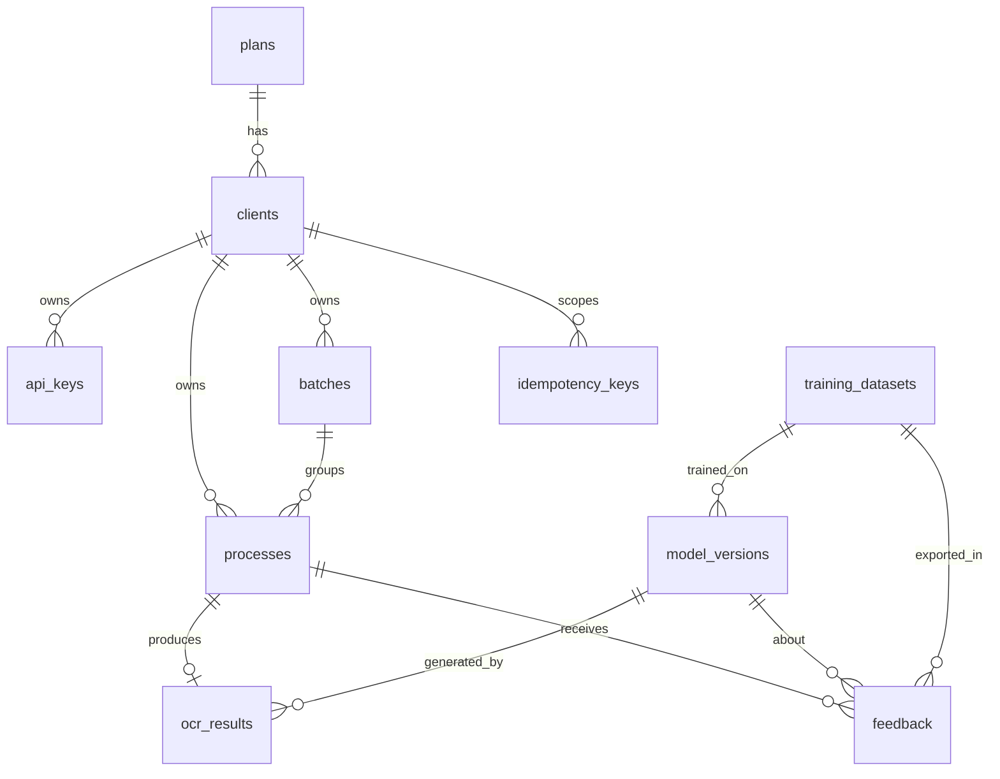

# Bill/Invoice OCR API — Architecture & Design

Status legend used throughout: **[impl]** implemented and tested · **[iface]** interface/integration point only · **[todo]** designed, not built.

## 1. Requirements analysis

Core promise: a client with an API key uploads a bill; we answer immediately with a `process_id`; work happens asynchronously; the client later reads a structured result and may submit corrections; corrections feed a *controlled* model-improvement loop. Non-negotiables: tenant isolation, key security, safe file handling, idempotent uploads, bulk intake, distributed rate limiting, observability, swappable OCR.

## 2. Ambiguities and the decisions taken

| # | Ambiguity | Decision (change if wrong) |
|---|---|---|
| 1 | Who creates tenants/keys? No self-service spec. | Internal admin API (`/internal/v1`, separate admin token, private network). No client-facing key management. |
| 2 | Which OCR/extraction model? | Undecided → `OCRProvider` + `Extractor` interfaces. Shipped: `UnconfiguredProvider` (fails loudly), `TesseractProvider` (reference), `RuleBasedExtractor` (heuristic baseline, **not** ML). |
| 3 | Languages/currencies/date formats (Nepal: NPR, BS calendar, Devanagari)? | English + Latin digits; NPR/USD/EUR/INR/GBP set. **Bikram Sambat dates and Devanagari are not handled** [todo]. Day-first dates assumed (configurable), ambiguity flagged. |
| 4 | Accepted files? | PNG, JPEG, single- or multi-page PDF (≤ `max_pdf_pages`). No TIFF/HEIC/WebP. |
| 5 | Result shape for money: numbers or strings? | Contract shows numbers → API emits JSON numbers; storage keeps exact decimal strings. |
| 6 | Feedback semantics: replace result? | No. Feedback is append-only and never mutates the original result. A "corrected view" endpoint is [todo]. |
| 7 | May corrections train models for every tenant? | Only tenants with `training_opt_in=true` (contractual consent). |
| 8 | Data retention? | Per-plan/per-client `retention_days` (default 30); purge job + explicit `DELETE`. |
| 9 | Webhooks vs polling? | Polling only for now. Webhook delivery [todo]. |
| 10 | Quota period? | UTC day / UTC calendar month; deleted docs still count. |
| 11 | Scale targets unknown. | Designed stateless/horizontal; no load testing was done. |

## 3. Architecture

```mermaid
flowchart LR
  C[Client app] -->|HTTPS + X-API-Key| LB[TLS load balancer / WAF]
  LB --> API1[FastAPI replica 1..N<br/>stateless]
  API1 --> PG[(PostgreSQL<br/>system of record)]
  API1 --> RD[(Redis<br/>rate limits, broker)]
  API1 --> S3[(S3 / MinIO<br/>documents, OCR artifacts)]
  RD -->|ocr queue| W[Celery OCR workers 1..M<br/>no inbound ports]
  W --> S3
  W --> PG
  W --> OCR[[OCRProvider<br/>tesseract | cloud | custom]]
  W --> EX[[Extractor<br/>rules | layout model]]
  BEAT[Celery beat x1<br/>reaper + retention] --> RD
  ADM[Operator] -->|private network| API1
  ML[Offline ML jobs] -->|dataset export| PG
  ML --> REG[(model_versions registry)]
  API1 -. /metrics .-> PROM[Prometheus]
  W -. logs/metrics .-> PROM
```

Layering inside `app/`: `api` (thin routes, deps) → `services` (use-cases, transactions) → `repositories` (tenant-scoped queries) → `models`. Side-effect adapters behind interfaces: `storage` (S3/local), `queue` (Celery), `ocr`, `extraction`. The composition root is `core/container.py`; tests inject fakes there.

Request path (`POST /api/v1/bills`): IP limit → API-key auth → key/tenant limits → scope → upload limit → queue-depth backpressure → stream+validate file → idempotency lookup → upload object → **one short DB transaction** (tenant row lock → capacity check → process rows → idempotency record → audit) → commit → enqueue → `202`.
Enqueue happens after commit; if it fails the row stays `queued` and the **reaper** re-enqueues it (closes the dual-write gap without an outbox table).

## 4. Database (PostgreSQL; `migrations/versions/0001_initial_schema.py`)



Key design points: client-visible process IDs are exactly 20 random lowercase alphanumeric characters (about 103 bits, no prefix); all other IDs are prefixed 122-bit random strings (`batch_…`, `cli_…`). `processes` has `UNIQUE(client_id,id)` and `ocr_results`/`feedback`/`processes→batches` use **composite FKs on (client_id, …)**, so the database itself refuses cross-tenant rows. Partial unique index guarantees ≤ 1 `active` model per kind. `audit_logs` has no FK (outlives tenants). Hot indexes: `(client_id, created_at)`, `(client_id, status)`, `(status, updated_at)` (reaper), `(expires_at)` (retention), `UNIQUE(client_id,key)` (idempotency). Extraction results, field confidences and issues are JSONB. Soft delete: `processes.deleted_at`, `clients.deleted_at`.

Not built: row-level security (RLS) as a third isolation layer, table partitioning for `audit_logs`/`processes` [todo].

## 5. API contract (all JSON, `X-API-Key` header; errors `{"error":{code,message,request_id,details?}}`)

| Method & path | Scope | Notes |
|---|---|---|
| `POST /api/v1/bills` multipart `file`, optional `metadata` (flat JSON), `Idempotency-Key` header | bills:write | `202 {process_id,status:"queued",created_at}` + `Location` |
| `POST /api/v1/bills/bulk` multipart `files[]` | bills:write | `202 {batch_id,status,accepted,rejected,processes:[{index,filename,process_id\|null,status:"queued"\|"rejected",error?}]}` |
| `GET /api/v1/bills/{process_id}` | bills:read | status, `result`, `confidence`, `field_confidence`, `requires_review`, `issues`, `model_versions`, `error` |
| `GET /api/v1/bills/batches/{batch_id}` | bills:read | aggregate status + per-process status |
| `POST /api/v1/bills/{process_id}/cancel` | bills:write | only while `queued` |
| `DELETE /api/v1/bills/{process_id}` | bills:write | purge document + result |
| `POST /api/v1/bills/{process_id}/feedback` `{corrections:[{field,value}],comment?}` | feedback:write | `201`; atomic; `422` lists every invalid correction |
| `GET /healthz`, `/readyz`, `/metrics` | – | metrics needs bearer token (hidden in prod if unset) |
| `/internal/v1/clients…`, `…/api-keys`, `…/revoke`, `…/rotate` | admin token | operators only |

Status codes: 401 bad/missing/expired/revoked key · 403 scope / suspended · 404 unknown **or other tenant's** id · 409 bad state · 413 too large · 415 bad type · 422 validation / idempotency mismatch · 429 (+`Retry-After`) · 503 (+`Retry-After`) queue saturated / limiter or storage down.
Correctable fields: `vendor, invoice_number, date, currency, subtotal, tax, total, items[n].{description,quantity,unit_price,amount}` (`n` ≤ current item count; `value:null` = "should be empty").

## 6. Security model

| Concern | Control | Status |
|---|---|---|
| API-key storage | `ocr_<12hex prefix>_<256-bit secret>`; stored as HMAC-SHA256(server pepper, key); lookup by prefix; constant-time compare incl. dummy compare when prefix unknown; shown once | impl |
| Key lifecycle | create, revoke, rotate (old key gets bounded grace then expires), expiry, scopes, `last_used_at` (throttled writes) | impl |
| Tenant resolution | only `key → client → plan`; `client_id` in body/headers ignored; repos require `client_id` in every lookup; cross-tenant access returns 404 | impl + tests |
| Defence in depth | composite FKs; object keys embed tenant & are server-generated | impl |
| Brute force | per-IP pre-auth limit; per-IP auth-failure limiter → 429 | impl |
| Upload safety | size cap streamed, magic-byte sniffing (ignores extension/Content-Type), full image decode under pixel cap (decompression bombs), PDF: parse, page cap, reject encrypted, reject `/JavaScript /Launch /EmbeddedFile /OpenAction /AA /XFA…`, filename sanitised & never used in paths, path-traversal-proof storage keys | impl |
| Known gap | PDF active-content check scans raw bytes; content hidden inside compressed object streams is not inspected; no AV/CDR scan; rendering (pdfium) not sandboxed beyond container limits | **limitation** |
| Injection | SQLAlchemy parameterised queries only; no shell-outs; no URL fetching anywhere (no SSRF surface); Celery JSON serializer only (no pickle) | impl |
| Errors | generic 500, validation errors never echo input, request-id on every response, stack traces to logs only | impl |
| Headers/CORS | nosniff, frame deny, CSP none, HSTS, no-store; CORS off by default (server-to-server), wildcard forbidden in prod | impl |
| Secrets | pydantic `SecretStr`; app refuses to boot without pepper/admin token; prod requires ≥ 32 chars; logs redact key patterns & sensitive fields | impl; secret-manager wiring [todo] |
| Audit | submit/cancel/delete/feedback/key & client lifecycle in `audit_logs`, same transaction as the action | impl |
| PII | documents/OCR text only in encrypted object storage (SSE configurable), never in logs; retention purge; erasure tombstones results; training use requires opt-in; dataset export pseudonymises tenant | impl (encryption at rest depends on deployment) |
| Transport | TLS terminated at load balancer (not in app) | deploy |
| Container | non-root, read-only rootfs, `cap_drop ALL`, `no-new-privileges`, resource limits, separate API/worker images, worker has no inbound port | compose (unverified: Docker unavailable here) |
| Dependencies | pinned minimums only; **no vulnerability scanning run** | todo |
| Admin API | separate token, must be unreachable from the internet | deploy |

## 7. Rate limiting & quotas

All limits are columns on `plans` (seeded `free/pro/enterprise`), never constants.
* Redis sliding-window-log (atomic Lua) so every replica shares state: per-IP (pre-auth), per-IP auth failures, per-API-key, per-tenant, per-tenant upload endpoint. `429` + `Retry-After` + `X-RateLimit-*`. Redis outage: fail-closed (`503`) by default, fail-open configurable.
* Concurrency (`queued+processing`), daily and monthly document quotas are computed from **PostgreSQL** (authoritative, no counter drift) under a per-tenant row lock, so parallel uploads cannot overshoot (verified on real PostgreSQL). Deleting a document does not refund quota.
* Plan file-size / batch-size / batch-bytes limits sit under hard global ceilings in settings.
* Global backpressure: if Redis queue depth ≥ `queue_max_depth` → `503 queue_saturated`.

## 8. Bulk processing

`POST /bills/bulk`: ≤ `max_batch_size` files and ≤ `max_batch_bytes`; each file validated independently; invalid files become `rejected` items with an error while the rest proceed; capacity shortfall (concurrency/quota) accepts a prefix and rejects the remainder as `retryable`; zero capacity → whole-request `429`. One `Idempotency-Key` covers the batch (replay returns the identical body). `GET /bills/batches/{id}` aggregates. Clients needing > ~200 files or > ~1 GB per call need pre-signed direct-to-S3 upload [todo].

## 9. Idempotency

`Idempotency-Key` (8–128 safe chars), scoped `(client_id,key)`, TTL 24h, stores `request_hash` (file SHA-256s + metadata) and the original response. Same key+same payload → original response + `Idempotent-Replay: true`; same key+different payload → `422`. Only successful (202) responses are stored; concurrent twins are serialised by the tenant lock (8-way race verified on PostgreSQL).

## 10. OCR / AI pipeline

`bytes → sandboxed render (+ optional preprocessing ops) → OCR per page → layout → extractor → normalise (with provenance) → validate → heuristic confidence → persist result + internal evidence`. Details, rules and limits: [`ML_PIPELINE.md`](ML_PIPELINE.md). OCR (`app/ocr`) knows nothing about invoices; extraction (`app/extraction`) consumes `OCRResult` (pages, lines, word boxes, per-page status) so a learned layout model can replace the rules without touching OCR or the API. Raw OCR JSON is stored in object storage (not Postgres). Every result stores OCR and extractor model-version ids (the extractor that **actually produced** the result, which is the reference extractor after a fallback), `schema_version`, `preprocessing_version`, stage versions and stage timings. `requires_review` is set when overall confidence < threshold, any error-level issue exists, or any page failed.
**Confidence numbers are uncalibrated heuristics**; calibrate against labelled data before anyone automates on them.

State machine (enforced by SQL compare-and-swap, so duplicate deliveries/reapers/cancels can't double-apply):
`queued → processing → completed | failed`, `processing → queued` (retry), `queued → cancelled`. Retry budget lives in `processes.attempts/max_attempts` (not in Celery); transient errors back off 20s/40s/…; exhausted → `failed` (the DB row is the dead-letter record; safe error code/message only). `acks_late`, `reject_on_worker_lost`, prefetch 1, hard time limit < stale-processing threshold.

## 11. Feedback → ML improvement

```
client correction → validate (tenant, completed, allowed fields incl. v2, typed values, no-ops, atomic) → feedback rows (original copied server-side)
 → [operator] propose example   (tenant training_policy must be tenant_only|pooled; conflicts, totals, duplicates, failed pages are flagged, never repaired)
 → [operator] review → approved example  (blocking issues prevent approval; consent re-checked)
 → dataset snapshot  (scope pooled | tenant:<id>; group-wise deterministic split; evaluation groups never overlap training groups; checksum)
 → Trainer (interface only, readiness policy, reproducibility metadata, signed artifact) → CANDIDATE model_version
 → immutable evaluation_runs on a held-out evaluation dataset
 → registry gates vs the production model on the same data → approved → promote (one production per kind) → rollback supported
 → workers load the production model once (verified, signed), else the reference extractor
```
Nothing in this path can change production behaviour automatically, and the only tenant-facing step is submitting corrections. There is no trainer implementation; see `BENCHMARK.md` for why.

## 12. Repository structure
See `README.md` (directory tree).

## 13. Deployment architecture
Local: `docker-compose.yml` (Postgres, Redis, MinIO + bucket init, migrate job, API, worker, single beat). Production: managed Postgres (pool via PgBouncer), Redis with persistence & `noeviction` (HA), S3 with SSE-KMS and lifecycle rule for orphans, API behind TLS LB/WAF (set `OCR_TRUSTED_PROXY_HOPS`), workers autoscaled on `ocr` queue depth/age, exactly one beat, admin listener on private network, Prometheus scraping API `/metrics` (bearer) and worker metrics on `:9100` (Celery prefork, `PROMETHEUS_MULTIPROC_DIR` required; private network only). Migrations run as a one-shot job before rollout.

## 14. Testing strategy
Pyramid: unit (validation, keys, limiter, state, normalisation, extraction, feedback rules) → API/integration with real ASGI app, SQLite+fakeredis by default, **real PostgreSQL (through Alembic) + real Redis Lua** via `OCR_TEST_DATABASE_URL` / `OCR_TEST_REDIS_URL` → PG-only race tests → S3 via moto → manual e2e smoke (`scripts/e2e_smoke.py`) against a running stack. Fakes live only in `tests/`.

## 15. Failure modes
| Failure | Behaviour |
|---|---|
| Redis down | Limiter fail-closed `503` (configurable); uploads impossible; accepted jobs stay in Postgres |
| Broker loses messages / enqueue fails | Reaper re-enqueues stale `queued`; duplicates skipped by CAS |
| Worker crash mid-job | redelivery is skipped (`not_queued`), so a job cannot run twice; the reaper returns it to `queued` after `stale_processing_seconds` (default 900s > 300s time limit) until attempts are exhausted, then `failed/worker_timeout`. Verified by SIGKILL on a real stack |
| OCR engine transient error | retry with backoff; permanent → `failed` with safe code |
| Object storage down | intake `503` + Retry-After; worker retries |
| DB commit fails after object upload | orphan object cleaned best-effort; bucket lifecycle rule recommended |
| DB down | `/readyz` 503; requests answer `503 database_unavailable` with Retry-After, never a success; workers error and retry |
| Poison document | bounded attempts → `failed`; no infinite loop |
| Slow worker exceeds reaper window | time limit (300s) < stale threshold (900s) prevents double processing |
| Hot tenant | per-tenant row lock serialises only that tenant's submissions; limits bound its share |
| Pepper lost/rotated | all keys invalid → treat pepper as a critical secret; pepper rotation needs dual-verify support [todo] |
| Clock skew between replicas | minor window-edge drift in limiter |

## 16. Platform hardening (v0.2)
**Error contract.** Every error is `{"error":{"code","message","request_id"[,"details"]}}`; codes are lowercase snake_case. Unhandled exceptions, SQL errors (`503 database_unavailable` for connectivity/timeouts, generic `500` otherwise) and storage errors (`503 storage_unavailable`) never reveal internals.

**Request size.** A pure-ASGI limiter counts bytes actually received, so chunked bodies without Content-Length are also capped (413 `payload_too_large`).

**Untrusted document handling.** Validation runs in a child process with an empty environment and rlimits (address space, CPU, file size, open files, no core), a wall-clock timeout and process-group kill. The structural PDF check parses the object graph (so names hidden by hex escapes or inside compressed object streams are seen), bounds Flate/ASCII85/ASCIIHex decoding, caps object count, pages and image XObject dimensions. Page rendering for OCR runs in a sandboxed child the same way. Limits: not malware detection, not a kernel sandbox.

**Queues and fairness.** Interactive (`ocr`) and bulk (`ocr_bulk`) queues are separate, each with a depth cap (503 + Retry-After beyond it; bulk accepts partially). Workers enforce a per-plan `max_running_jobs` at claim time and defer (without consuming an attempt) when a tenant is at its cap. Run separate worker services per queue so bulk capacity cannot starve interactive jobs.

**State safety.** Process transitions are SQL compare-and-swap with an attempt-number fencing token; a stale worker cannot complete or fail a job that was re-claimed. The reaper threshold must exceed the job time limit (validated at startup), so it never requeues a live job.

**Limits and quotas.** Per-plan: per-key, per-tenant, upload and bulk requests/minute, documents/minute, concurrent jobs, running jobs, daily/monthly quota, file/batch size, pages. Quotas and concurrency are computed from the DB under a per-tenant `clients` row lock (atomic across replicas); rate limits are Redis sliding windows in Lua (fail-closed) and emit `Retry-After`.

**Database.** Migrations 0001 (schema) and 0002 (hardening columns, partial indexes `ix_processes_queued_enqueued`, `ix_processes_processing_started`, `ix_processes_client_processing` for the reaper, stale scan and running-job count). Production never uses `create_all`. Statement and lock timeouts are set per connection; pool wait is bounded.

**Observability.** `request_id` is stored on the process and carried to worker logs; client-supplied IDs are validated. JSON logs redact secrets. Worker metrics (received/completed/failed/retried/deferred, durations by stage, queue latency, active jobs, errors) use low-cardinality labels only. Tracing (W3C traceparent via Celery headers) is optional and off by default.

**Retention.** Document purge at `retention_days`, idempotency expiry, bounded audit-log purge (`audit_retention_days`, default 365), and an orphan-object sweep (objects older than 2h whose process row is missing or deleted).

**Model-version compatibility.** Results record OCR model, extractor model, `preprocessing_version` and `schema_version`; the API returns them as `model_versions` and `pipeline_versions`.

## 17. OCR / understanding / ML pipeline (v0.3)

* **Migrations 0003 and 0004.** 0003 adds `ocr_results.meta` (internal evidence, per-page status, stage versions). 0004 adds the tenant `training_policy` (existing opt-ins become `pooled`), `external_processing`, `training_examples`, `dataset_examples`, the immutable `evaluation_runs` (PostgreSQL trigger), registry columns (schema version, artifact digest, signature, training metadata) and renames registry states (`evaluating` to `evaluated`, `active` to `production`); `preprocessing_version` widens to 64 characters. Downgrade restores the old state names.
* **API compatibility.** Public endpoints and request bodies are unchanged. Responses gain optional keys (v2 fields, extra `pipeline_versions` keys); null fields are omitted, so v1 clients and historical v1 results are unaffected. Evidence is never returned.
* **Operator API** (`/internal/v1`, admin token): training policy, examples, datasets, models, evaluations, approve / promote / rollback / retire. Not reachable with a tenant key.
* **Failure containment.** Extractor crash or invalid output → reference extractor (recorded); no usable output → job fails with `extraction_failed` (no retry); failed page → document marked for review (or failed, by `OCR_PARTIAL_PAGE_POLICY=fail`); unloadable production model → reference extractor, metered; registry outage → keep the loaded model.
* **Privacy.** Consent by tenant, scope-isolated datasets, dataset artifacts without OCR text, erasure flags datasets, external providers denied by default.
* **What is not solved.** No labelled real data; no trained model; no calibrator; unlearning from trained models; cross-tenant duplicate detection (duplicates are detected within a tenant only).

## 18. Release audit additions (v0.3.0, 2026-10-01)
The operator token (`X-Admin-Token`) is now subject to the same per-IP failed-authentication budget as tenant keys (429 + `Retry-After`). Model artifact locations are restricted to `models/` and checked before any read. `GET /internal/v1/models` identifies models affected by consent withdrawal. An `unsupported_script` issue is raised when Devanagari characters appear in OCR output. Evidence, scans and open items are in [`RELEASE_AUDIT.md`](RELEASE_AUDIT.md). The status of this system is **not production-ready**.
